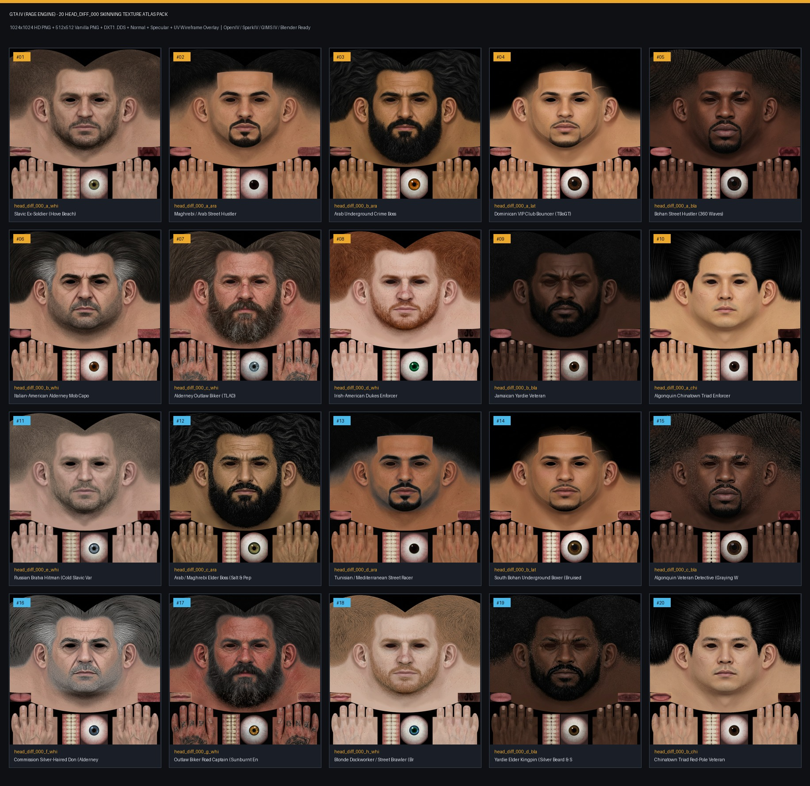

# GTA IV / MTA:SA — حزمة 50 خامة وجه

## تحميل الوجوه الخمسين من GitHub

[تحميل ملف ZIP للـ50 وجه](50_Faces_MTA_SA_GitHub.zip?raw=1) — يحتوي على 50 خامة PNG بمقاس 512، ونسخ JPEG بجودة عالية بمقاس 1024، وملفات DDS وخرائط Normal وSpecular والقوالب. نسخ الـ1024 داخل ZIP بصيغة JPEG لتبقى الحزمة تحت حد حجم الملف على GitHub؛ **ملفات PNG الأصلية بدقة 1024** متاحة كاملة في مجلد [`textures_1024/`](textures_1024/).

بعض الوجوه (11–20) نسخ معدلة من وجوه أخرى. خامات الـUV مبنية بأسلوب GTA IV وقد تحتاج إعادة ضبط الـUV لتطابق موديل الـDFF في MTA:SA. الاستوديو والبيانات الأصلية أدناه يعرضان المجموعة الأولى المكونة من 20 وجهًا فقط.

---

## GTA IV (RAGE Engine) — مجموعة `head_diff_000` الأصلية (20 وجهًا)

حزمة متكاملة مكونة من **20 تكستر وجه (`head_diff_000`)** مصممة خصيصاً لمحرك **Rockstar RAGE (GTA IV / EFLC: TLAD & TBoGT)** ومتوافقة 100% مع إحداثيات الـ **UV Atlas الأصلية** لتصميم السكنات والمودات في **OpenIV / SparkIV / 3ds Max (GIMS IV) / ZModeler / Blender** وكذلك لتحويل السكنات إلى **GTA SA / FiveM**.



---

## محتويات الحزمة (Directory Structure)

| المجلد / الملف | الوصف | الصيغة والأبعاد |
|---|---|---|
| `textures_1024/` | **20 خريطة Diffuse بجودة HD** لتصميم السكنات الاحترافية والمودات عالية الدقة | `PNG` (`1024×1024` RGB) |
| `textures_512/` | **20 خريطة Diffuse بالأبعاد القياسية الأصلية لنسخة GTA IV PC** | `PNG` (`512×512` RGB) |
| `dds_512/` | **20 ملف `.dds` جاهز للاستيراد المباشر** داخل ملفات `.wtd` عبر OpenIV / SparkIV بدون أي تحويل | `DDS DXT1` (`512×512` + 9 Mipmaps) |
| `normals_512/` | **20 خريطة Normal Map (`head_normal_000`)** لإبراز المسام، الندبات، وتفاصيل اللحية والجلد | `PNG` (`512×512` Tangent-Space RGB) |
| `specular_512/` | **20 خريطة Specular Map (`head_spec_000`)** لضبط لمعان البشرة والعيون داخل محرك RAGE | `PNG` (`512×512` RGB) |
| `templates/` | قوالب التصميم لمصممي السكنات: شبكة `gta4_uv_wireframe_1024.png` شفافة للفوتوشوب وبلندر + خريطة المناطق `gta4_uv_guide_labeled.png` | `PNG` (`1024×1024` / `512×512`) |
| `GTA_IV_20_Face_Maps_Catalog.jpg` | كتالوج بصري شامل يستعرض الـ 20 تكستر جنباً إلى جنب | `JPG` |

---

## مواصفات تقسيم الـ UV الأصلي في GTA IV (`head_diff_000`)

كل تكستر مبني بدقة البكسل على توزيع `head_diff_000` القياسي في GTA IV (على مقياس `1024×1024`):
- **الوجه، فروة الرأس (Butterfly Scalp Wrap)، الأذنان، والرقبة**: `x = 0..1024, y = 0..806`
- **العيون المفتوحة على الوجه**: قرب `(414, 350)` و`(610, 350)` في خرائط 1024؛ قد يتطلب استخدامها ضبط الـUV ليتناسب مع الموديل المستهدف.
- **مربع قزحية وبياض العين (3D Eyeball Sclera & Iris UV)**: `[482..668, 818..1024]` ومركز البؤبؤ عند `(574, 928)`.
- **شريط الأسنان واللثة العمودي (Teeth & Gums Strip)**: `[358..478, 816..1024]`.
- **جزر اليدين اليسرى واليمنى (Left & Right Dorsal Hands)**: `[0..340, 736..1024]` و`[672..1024, 736..1024]` متطابقة لونياً مع بشرة الوجه.
- **اللسان وتجويف الفم الداخلي**: `[0..144, 672..732]` و`[872..1024, 672..732]`.

---

## طريقة التركيب والاستخدام في تصميم السكنات

### 1. لتصميم سكنات MTA:SA و GTA San Andreas (`.txd` + `.dff`)
جميع الـ 20 خامة أصبحت الآن **بعيون بشرية طبيعية مفتوحة ومفصّلة مدمجة مباشرة في جزء الوجه** (بدون تجاويف سوداء)، مما يجعلها جاهزة فوراً لتركيبها على رؤوس شخصيات **MTA:SA**:
1. في **3ds Max (Kam's GTA Scripts)** أو **Blender (DragonFF)**: طبّق الخامة من مجلد `textures_512/` (خفيفة وسريعة لسيرفرات MTA) أو `textures_1024/` (لسكنات الـ HD) على مجسم الرأس واضبط الـ `UVW Unwrap` (يمكنك الاستعانة بملف `templates/gta4_uv_wireframe_1024.png`).
2. افتح برنامج **Magic.TXD** أو **TXD Workshop** لملف الـ `.txd` الخاص بالسكن، واستورد صورة الـ `PNG` (بضغط `DXT1`) أو استورد ملف الـ `.dds` الجاهز مباشرة من `dds_512/` ثم احفظ الملف!

### 2. عبر برنامج OpenIV أو SparkIV لـ GTA IV (`playerped.rpf` أو `componentpeds.img`)
1. افتح **OpenIV** وانتقل إلى `pc/models/cdimages/componentpeds.img` (أو `playerped.rpf`) وفعّل **Edit Mode**.
2. افتح ملف الـ `.wtd` الخاص بالشخصية (مثل `m_y_streetblk_03.wtd` أو `head_diff_000_a_whi.wtd`).
3. اختر التكستر `head_diff_000_*` واضغط **Replace** ثم اختر ملف الـ `.png` من `textures_512/` (أو `textures_1024/` لمودات الـ HD) أو استورد ملف الـ `.dds` مباشرة من `dds_512/`.
4. اختياري: استبدل `head_normal_000` و`head_spec_000` من مجلدي `normals_512/` و`specular_512/` ثم اضغط **Save**.

### 2. عبر 3ds Max (GIMS IV) أو Blender أو Photoshop
- افتح ملف `templates/gta4_uv_wireframe_1024.png` كطبقة علوية (Top Layer) في **Photoshop / GIMP** لمشاهدة حدود الشبكة أثناء إضافة الوشوم أو التعديلات الخاصة بك.

---

## تشغيل استوديو المعاينة التفاعلي (3D + 2D UV Studio)

```bash
python3 server.py
```
ثم افتح المتصفح لمعاينة الـ 20 تكستر على مجسم رأس ثلاثي الأبعاد، تفعيل شبكة الـ UV، وتحميل الحزم بصيغة ZIP.
